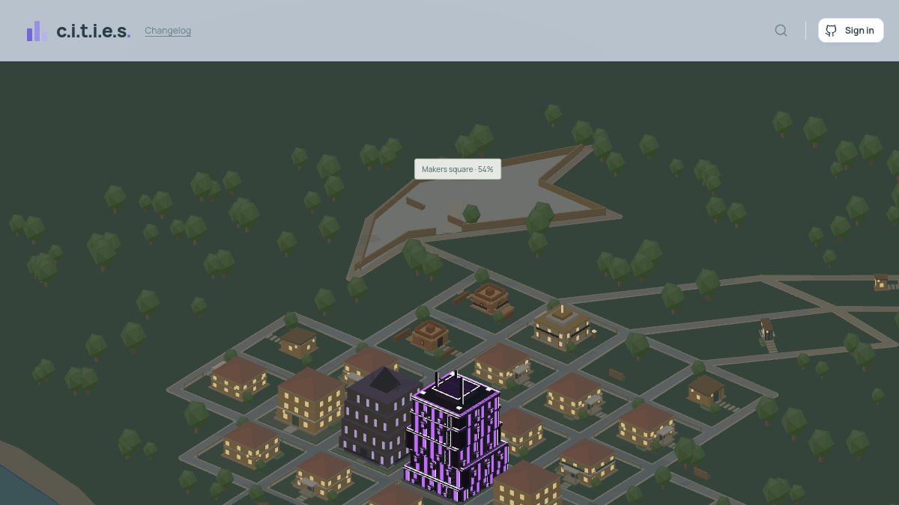

# C.I.T.I.E.S

**A little city of people who build things.**

[Visit the city](https://devcities.dev/)

## The core loop

1. Connect your GitHub account and move into the city.
2. Earn XP and bricks by building, contributing, and participating in the neighborhood.
3. Level up to grow your tower from a small home into a skyline landmark.
4. Spend bricks to make the tower your own and help build shared public spaces.
5. Invite new residents and watch the city grow around you.

## Earning XP

| Action | XP | Bricks |
| --- | ---: | ---: |
| Verified GitHub commit, up to 20 per day | 10 | 10 |
| Approved contribution merged into C.I.T.I.E.S | 100 | - |
| Invited resident joins the city | 200 | - |
| A resident likes your tower | 50 | - |
| A nearby tower levels up | 20 | - |
| Help complete a public project | 200 | - |
| Daily visit | 30 | 30 |

XP permanently grows your tower. Bricks are the city's spendable resource for customization and community projects.

## Contributing to C.I.T.I.E.S

C.I.T.I.E.S is open source, and contributions to the city are part of the game itself. When a resident opens a pull request, receives maintainer approval, and has it merged into the main branch, their linked C.I.T.I.E.S account receives **100 XP**.

Each merged pull request can earn the reward only once. The same commits can still earn the normal GitHub activity reward.

## Major mechanics

### Towers and progression

Every resident owns a persistent tower with 30 levels and ten visual stages. Levels increase its height, complexity, grounds, and available customization. Progress happens automatically as XP is earned.

### Bricks and customization

Bricks unlock architectural themes and let residents change tower segments, colors, and facade styles. Unlocked themes remain available for future redesigns. Residents can also buy decorations, walking neighbors, corner shops, and storefronts attached to their tower.

### Neighborhoods

New residents join through invitations and choose a plot near the person who invited them. Roads extend into new areas as the community grows. Residents can explore the 3D city, search for neighbors, view profiles, and like towers. Drag the Street view person onto a road or select a highlighted street to explore on foot, then pick up and place owned items around your property.

### Shared growth

Leveling up benefits nearby residents as well as the tower owner. This turns individual progress into neighborhood progress and rewards active clusters of builders.

### Public projects

Residents can pool bricks into shared places such as Riverside commons and Makers square. Projects visibly develop as they reach funding milestones, and meaningful contributors earn XP when construction is complete.

### GitHub activity

The city reflects verified GitHub work. Commits earn XP and bricks, profiles show contribution activity, and approved C.I.T.I.E.S contributions receive an additional reward.

### Daily rewards

Residents can claim a daily XP and brick bonus. Bricks earned while away are welcomed back into the city when they return.

### A living city

The city has a continuous coastline, growing roads, trees, parks, lighting that follows the viewer's local time, and detail that adjusts smoothly as you explore near and far.

## Local development

See [the development guide](docs/development.md) for setup, controls, local mock ownership and fixtures, migrations, lighting previews, rendering architecture, and validation commands.
